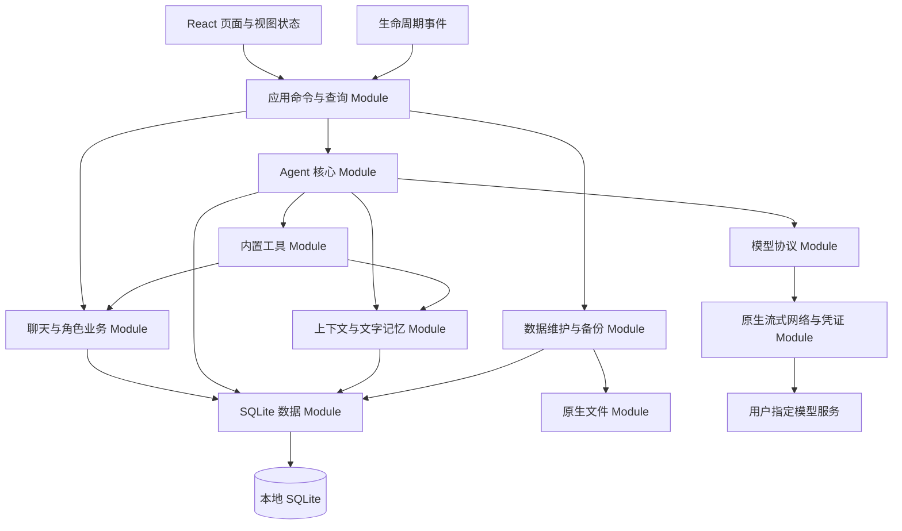

# Yomi 总体架构 v1.1

> 本轮功能更新：世界书、生图/语音/表情包和酒馆角色卡导入已实现，见 [功能、兼容范围与数据保留](13-WORLDBOOK-MEDIA-CHARACTER-CARDS.md)。下文旧版“暂无世界书/多媒体”约束已由本轮用户要求更新。

> 后续更新：独立暂存恢复、切库记录、旧库回退、存储维护及全量用量统计已接入，见[最新实现记录](10-STAGED-RESTORE-AND-MAINTENANCE.md)。历史快照中的对应缺口已过时；完整目标仍未全部验收。

> 当前实现更新见 [协作与数据可靠性更新](09-COLLABORATION-AND-DATA.md)。本文保留此前设计与实现快照；其中固定群轮、缺少 triage/角色模型/并发限制、明文备份及备份失败半清库的描述已过时。完整目标仍在推进，不能用历史 verified 直接宣称完成。

日期：2026-10-23（v1.1 修订）。状态：**Android v1 已实现**，本文记录已落地的架构与仍存在的偏离。设计基线见 git 历史中的 v1.0。

## 1. 产品目标与边界

Yomi 是用户自己配置模型服务的本地多 Agent 角色聊天 App。角色有稳定身份、人设、文字记忆和独立的对话判断；用户可与角色单聊、与多个角色群聊，也可旁观角色之间的私聊。

设备保存事实，模型服务负责推理。无 Yomi 官方账号、必需服务端、官方模型代理、电脑配对或在线同步前置。联网需求仅来自用户主动配置的模型请求；无网络时仍能管理角色、阅读与搜索历史、编辑草稿和操作本地数据。

### 1.1 用户已经确认的约束

1. 独立新项目，参考 Cumora 的多 Agent 机制重新实现；不继续向原工程添加本地分支。
2. 混合方案，Android 优先，未来 iOS 共用 TypeScript 核心和 SQLite 表结构。
3. 保留已认可的聊天操作习惯和四个入口：消息、私聊、角色、我；本轮不擅自重新发明页面交互。
4. SQLite 保存持久事实，内存保存可重建的即时协调状态；无需 PostgreSQL、Redis。
5. 不做旧云端接口适配层；UI 直接调用自己的应用业务接口。
6. 工具封装在 App 内，服务聊天、记忆和角色互动；无 shell、CLI 或工作型工具依赖。
7. 默认无向量记忆、无 embedding 请求；保留文字记忆和上下文压缩。
8. 多 Agent 自主判断与协作；不将其简化为点名各回复一次或全员固定顺序轮询。
9. 停止后终止受影响的生成和派生发言；重启保留历史，用户决定是否重试中断任务。
10. 先完成全面设计；实际重写等待用户稍后设置 goal。

### 1.2 已实现的 v1 范围

| 领域 | 实现方式 |
| --- | --- |
| 身份 | 一个 `local-user` 人类 Actor；角色稳定 UUID、头像 data URL、人设与启停 |
| 连接 | 多模型连接、main/summary 绑定、Android Keystore 凭证、连接测试、错误本地化 |
| 聊天 | 单聊、群聊、结构化点名、引用、表情反应、分页、草稿、已读、全局搜索 |
| 协作 | 按群轮依次发言、inbox 领取、新鲜度检查、近邻反重复、activity 预算 |
| 私聊 | 角色间 `agent_direct`/`agent_group` 只读旁观，可停止、可暂停 |
| 记忆 | 角色私有文字记忆、会话/全局范围、置顶、人工增删改、scope 迁移 |
| 控制 | 会话停止、全局停止、继续、重试、忽略，运行中断可恢复 |
| 数据 | SQLite 事务、列级迁移、明文 JSON 备份整库替换、角色/聊天导出、清空删除 |
| 手机 | 安全区、返回栈、后台停止、进程死亡后恢复、原生 Keystore 与文件保存 |
| 工程 | 类型检查、模拟器验收、debug APK；无真实模型、无真机、无 release |

### 1.3 明确不做

资料库、文档协作、看板、项目、交付、邮件、工作日历；任意 shell、网页浏览器控制、MCP 市场或第三方插件执行；剧情状态机、世界书、分支剧情、消息版本候选与再生成分支；图片/文件作为聊天输入、语音通话/TTS、图片生成；本地大模型推理、向量记忆；云账号、多真人联网聊天、跨设备实时同步、角色市场、付费订阅、常驻云端 Agent。

头像图片属于角色资料资产，已实现为 data URL 存库；这不意味着支持发送图片聊天。逻辑重试属于执行恢复，不是生成多个候选回答。聊天关键词搜索不属于“资料库”。

## 2. 独立性与参考边界

在 `E:/douyin/yomi` 新建自己的工程，保留现有 Cumora 原型不动。第一份 schema、提示词、工具名、运行记录和备份格式均属于 Yomi，不延续其 company/workspace/host/Pod/CLI 数据结构。

参考 Cumora 是为了理解它解决过的协调问题，不按原文件逐段翻译。实现按 Yomi 自己的模块接口写，用自己的场景验收。没有复用 Cumora 的代码或素材；不因改名或由 AI 改写而宣称完全原创，也不声称这构成法律意义的 clean-room 开发。

Cumora 原型的测试与 APK 不计入 Yomi 的成绩；本工程的完成状态以 05-DELIVERY.md 的记录为准。

实现要点：数据库名 `yomi`，appId `app.yomi.mobile`；头像以 data URL 存入 `actors.avatar_data`，没有独立资产目录。

## 3. 技术选择与已锁定版本

| 部分 | 设计选择与理由 |
| --- | --- |
| UI | React + TypeScript，Vite 构建；聊天列表虚拟化；自己的页面与样式代码 |
|---|---|
| 页面状态 | React 局部 state + `version` 计数器重建查询；数据事实只来自 SQLite |
| 移动壳 | Capacitor 8；Android 壳与一个自写 Java 插件 `SecureVaultPlugin` |
| 持久化 | `@capacitor-community/sqlite` 8.1.1，原生 SQLite，未加密 |
| 输入校验 | TypeScript 类型 + 逐处边界检查，无独立运行时 schema 层 |
| 模型接入 | 自实现 Responses / Chat Completions 请求与解析，无 Agent 框架 |
| 网络 | 原生 `HttpURLConnection` 整包读取（非流式），有界 8 MiB，可取消 |
| 凭证 | Android Keystore AES/GCM 密钥加密后存 SharedPreferences；iOS 未实现 |
| 文件 | Capacitor Filesystem 写 `Documents`；导入用 `<input type=file>` |
| 测试 | 类型检查 + 模拟器手工验收，无自动化测试套件 |
| 版本 | lockfile 固定；见下表 |

已锁定组合：Node 20 + npm、TypeScript 5.6.3、Vite 5.4.10、React 18.3.1、Capacitor 8.3.3、`@capacitor-community/sqlite` 8.1.1、AGP/Gradle 由 `android/` 工程自带，`minSdk 24`、`compileSdk`/`targetSdk 36`。

浏览器是开发与测试宿主，不属于发行平台；桌面只提供便于开发的响应式布局。

## 4. 整体结构与数据流



只有 `createApp`（`src/app/bootstrap.ts`）负责装配依赖与创建实例。React 挂载/卸载不创建第二个运行时；切标签和切会话不会终止聊天。原设计的 `runtimeSessionId` 与 fencing token 未实现；重入保护由进程内的 `runs`/`controllers` Map 加持久 `cancel_epoch` 共同完成。

不搭建本地 HTTP 服务器，不模拟 Cumora API/WS，不保留通用“Redis 模拟器”，不引入 Node 到安装包。原生接口只承接确实不同的平台能力，不包含群聊规则或各写一套业务 SQL。

## 5. 实际模块划分与职责

这里不是 monorepo workspace，而是一个 Vite 应用。Module 指一组隐藏实现、对外只开放一个入口的代码。

| Module | 实际文件 | 对外接口 | 未实现的部分 |
| --- | --- | --- | --- |
| presentation | `src/main.tsx`、`src/components/`、`src/styles.css` | 四个入口的页面与交互 | 无独立 design token 层、深浅主题、虚拟列表、无障碍 |
| application | `src/app/bootstrap.ts` | `AppApi`：命令、查询、控制、导入导出 | 无 `subscribe` 抽象，用 `version` 计数器触发重建 |
| agent-core | `src/agent/runtime.ts` | 唤醒、停止、恢复、运行快照 | 无 triage、无跨会话公平队列、无并发信号量 |
| tools | `src/agent/tools.ts` | 11 个工具的定义与执行 | 无 schema 运行时校验层 |
| context-memory | `src/agent/runtime.ts`（`buildContext`、`compactIfNeeded`） | 上下文构建、文字记忆、摘要 | 无 token 预算与 tokenizer 估算 |
| model-protocol | `src/model/protocol.ts` | 请求构造、响应解析、用量 | 无 SSE、无能力分层报告、无流式取消 |
| persistence | `src/data/database.ts`、`src/data/schema.ts`、`src/data/repository.ts` | 单连接队列、写事务、列级迁移、领域原子操作 | 无 `domain_events` 表、无 runtime lease、无 scheduled jobs |
| platform | `src/platform/secureTransport.ts`、`android/app/src/main/java/app/yomi/mobile/SecureVaultPlugin.java` | 凭证存取、原生请求与取消 | 无 iOS 实现、无背压、无分块流 |
| data-management | `repository.exportBackup`/`importBackup` | 明文 JSON 备份整库替换、聊天与角色导出 | 无加密容器、无 staging journal、无维护锁 |

### 5.1 工程目录

```text
yomi/
  docs/                   设计与验收记录
  src/
    agent/                runtime.ts、tools.ts
    app/                  bootstrap.ts（唯一装配）
    components/           avatar、icons、markdown
    data/                 database、schema、repository
    domain/               types.ts
    model/                protocol.ts
    platform/             secureTransport.ts
    main.tsx              页面与导航
    styles.css
  public/logo.png
  android/                Capacitor Android 工程 + SecureVaultPlugin
```

依赖方向：`main.tsx` → `bootstrap.ts` → {`agent`、`model`、`data`、`platform`} → `domain/types.ts`。`data` 不认识模型，`model` 不认识角色，`agent` 不认识 React。

```text
yomi/
  docs/                         本设计及未来验收证据
  apps/mobile/
    src/bootstrap/              唯一装配与启动顺序
    src/application/            UI 使用的命令、查询与状态投影
    src/features/               conversations, whispers, characters, settings
    src/ui/                     共用基础控件、主题、导航、可访问性
    android/                    Android 工程与小型自有 Capacitor 插件
    ios/                        后续 iOS 宿主与插件
  packages/domain/              ID、数据类型、校验、错误与纯规则
  packages/agent-core/          调度、triage、协调、turn 与工具执行
  packages/context-memory/      提示词构造、摘要、记忆范围与预算
  packages/persistence/         SQL、迁移、原子领域存储操作
  packages/model-protocol/      Responses / Chat Completions 和 SSE
  packages/platform/            手机能力接口与 TS 桥接封装
  tests/{contract,integration,e2e,scenarios}/
  tooling/                      测试模型、依赖规则、构建与证据脚本
```

### 5.2 依赖约束

- `domain/types.ts` 不 import 任何其他模块。
- `agent/runtime.ts` 只依赖领域类型和注入的 `Repository`、providers/bindings 取值函数；不 import React 或 Capacitor 插件。
- `model/protocol.ts` 只依赖 `platform/secureTransport` 与领域类型；不写聊天记录。
- `data/repository.ts` 只依赖 `data/database` 与领域类型；不调用模型。
- `platform/secureTransport.ts` 不认识角色、人设或记忆；只做凭证、origin 校验和 HTTP。
- `main.tsx` 只通过 `AppApi` 访问业务；不直接写 SQL、不发模型请求。
- `bootstrap.ts` 是唯一同时 import 上述具体实现并组装的地方。
- 当前没有 ESLint 或依赖扫描 CI；以上约束靠代码审查维持。

## 6. 应用接口与错误契约

以下是 `src/app/bootstrap.ts` 实际导出的接口形状。

```ts
interface AppApi {
  // 命令
  sendUser(conversationId, body, quotedId?, mentionIds?): Promise<Message>
  saveAgent(agent): Promise<Actor>; copyAgent(id); deleteAgent(id)
  openDirect(agentId); createGroup(title, members, topic?)
  updateConversation(id, patch); updateMembers(id, addIds, removeIds)
  saveMemory(memory); deleteMemory(id); moveMemoryScope(id, conversationId)
  saveProvider(provider, secret?); saveBinding(binding); deleteProvider(id)
  exportBackup(): Promise<string>; importBackup(fileName, content?)
  // 控制
  stop(conversationId); stopAll(); resume(id); retry(id); ignoreRecovery(id)
  // 查询
  conversations(includeHidden?); whispers(); conversation(id)
  messages(id, before?); messagesAround(id, messageId)
  memories(agentId, conversationId?); searchMessages(query); usage(); runtimeIssues()
  // 生命周期
  refresh(): Promise<void>
}
```

约定：

1. 用户发送成功表示消息、inbox 事件和命令回执已同事务落盘；不表示模型已回复。
2. `sendUser` 每次生成新的 `commandId`（`crypto.randomUUID()`），因此连点两次会产生两条消息；`command_receipts` 表的幂等能力存在但 UI 未复用同一 commandId。
3. 数据变化通过 `onChange()` 递增 `version`，页面按 `version` 重建查询；无跨进程订阅。
4. 启动失败在页面显示“启动失败：原因”，不清库、不回落任何默认服务。
5. 写操作全部串行短事务；摘要与网络调用不在事务内。
6. `stop` 在单事务内递增 `cancel_epoch`、取消 inbox 与 runs，随后 AbortController 取消网络；迟到工具提交会因 epoch 不匹配被拒。
7. 备份/恢复/清空没有维护锁，是直接的全表删除与插入；导入不是 staging 原子切换。

领域错误用中文 message 直接呈现，`errorText()` 把已知 code 映射为可操作提示（凭证缺失、地址变更、已取消、网络失败、401/403/429）。错误不会包含 Key 或完整提示词。

## 7. 数据与一致性原则

持久事实只存在 SQLite；头像以 data URL 存在 `actors.avatar_data`，没有独立资产目录。角色/会话/消息/记忆不是 localStorage 或 React state 的长期事实。

“消息+inbox+命令回执”“工具动作结果+消息+activity 计数”“停止+epoch+inbox+runs”各自在同一写事务内提交。`Database.write()` 用一条 Promise 队列串行化所有读写，插件默认的每语句自动事务被 Proxy 关掉，因此事务内不会嵌套 BEGIN。[SQLite 事务文档](https://sqlite.org/lang_transaction.html)

用户已读（`user_reads`）、Agent 已处理（`inbox_events.status`）、模型实际已见（run 内 `through`）是三个不同概念。一个 run 只构建一个会话的上下文。工具权限由宿主持有的 `agent.id` 决定，模型无法指定作者身份。

实际 schema、事务细节与缺口见 [数据与存储](02-DATA.md)。

## 8. 多 Agent 核心原则

运行时以 Agent 为串行执行单位（`runs` Map 保证一个 Agent 同时只有一个 run），以会话为上下文和停止单位，以 activity 为有界因果链单位（24 条发言 / 64 次模型调用 / 180 秒）。

第一轮产品规则是有界轮流，不是自主判断：见 [运行机制](03-AGENT-RUNTIME.md) 的群轮定义。

新消息进入可靠 `inbox_events`；忙碌时同一 Agent 的后续工作排队，运行期间的新消息在 hop 边界以 steer 形式注入。回复提交前在同事务内检查 `cancel_epoch`、成员资格、activity 预算、新鲜度和近邻重复；必要时返回 HELD。见 [运行机制](03-AGENT-RUNTIME.md)。

## 9. 原生执行与资源所有权

Android 侧只有一个自写插件 `SecureVaultPlugin`，提供 `set`、`setWithoutSecret`、`status`、`remove`、`request`、`cancel` 六个方法。

`request` 在原生 `ExecutorService` 线程上执行 `HttpURLConnection`，整包读取响应体（上限 8 MiB）后一次性回传 JS。请求前从 Keystore 解出凭证，校验目标 origin 与保存时一致，注入 `Authorization: Bearer`。`cancel` 断开连接并中断线程。连接超时 30 秒，读取超时 180 秒，禁止跟随重定向。

JS 侧没有任何读取已有 Key 的方法。Key 录入走原生 AlertDialog，网页层不接收明文；`storeCredential` 在原生平台只传空 secret 加 origin。浏览器开发宿主用内存 Map 存 Key，仅用于本地调试，不进入 APK 行为。

未实现：SSE 流式、分块与 ACK 背压、跨 owner 的 fencing token、`SqliteDriver`/`FileStore`/`BackupCrypto` 抽象接口、iOS 插件。

## 10. 生命周期与恢复

v1 明确选择**前台执行、后台暂停、返回后用户决定继续**。不是假设 WebView 能常驻：移动系统可能暂停或终止进程。[Android 生命周期](https://developer.android.com/guide/components/activities/process-lifecycle)、[iOS 后台执行](https://developer.apple.com/documentation/uikit/extending-your-app-s-background-execution-time)

实现的实际行为：

- 切 App 内标签/会话：保持运行，只改变观察视图。
- 退到后台（`@capacitor/app` 的 `appStateChange`）：对所有正在运行的会话调用 `stop`，取消网络并把 runs 标 cancelled；不自动继续。
- 进程被杀/强制停止：下次启动 `runtime.start()` 调 `interruptStaleRuns()`，把非终态 runs 标 `interrupted`，`inbox_events.claimed` 标 `deferred`；消息页显示“上次回应被中断”卡片，提供打开/重试/略过，都由用户触发。
- WebView 重载：`Database.open()` 先 `isTransactionActive` 探测并回滚残留事务，再执行列级迁移。
- 导入备份/清空数据：直接在当前库上全表删除与插入；没有维护模式、没有 staging、没有 manifest journal。

v1 不申请长期前台服务，不以定时任务重启对话。未完成任务以可见“继续/重试/忽略”呈现；已有历史可随时看。

## 11. 隐私、性能与可观察性

- 模型只收到本次允许的角色资料、上下文、记忆、工具 schema 与结果；所有涉及三方模型传输的状态在连接页明确说明。
- 远端头像与 Markdown 图片不自动加载；外部链接经 `window.open` 交系统浏览器；Markdown 渲染禁原始 HTML，只放行 `http/https/mailto`。
- 默认无遥测/广告 SDK、无自动 crash 上传、无隐藏官方端点或模型自动发现请求。
- 数据库受 App 沙箱和系统设备加密保护；未启用 SQLCipher。凭证由 Keystore 加密；备份是明文 JSON，未加密。
- 消息列表分页 50 条，`inbox_events` 查询上限 60 条，上下文取最近 36 条；没有虚拟列表，长会话当前页全量渲染。
- 本地记录运行阶段、原因、次数、用量、延迟和错误 code；不存完整思维链，不将模型内部 reasoning 展示成角色消息。
- 用量不可知时存 NULL，界面显示“部分用量未知”；没有价格估算功能。

## 12. 扩展位置与禁止的预实现

未来 iOS 可以复用 `src/agent`、`src/data`、`src/domain`、`src/model` 和 schema，需要补的是 iOS SQLite 驱动、Keystore 等价物与 Keychain 网络实现，以及 Xcode 工程。共享的是代码与数据格式，不是已构建的 iOS 产物。

逐项需求状态与验证证据见 [实施与验收](05-DELIVERY.md)。
